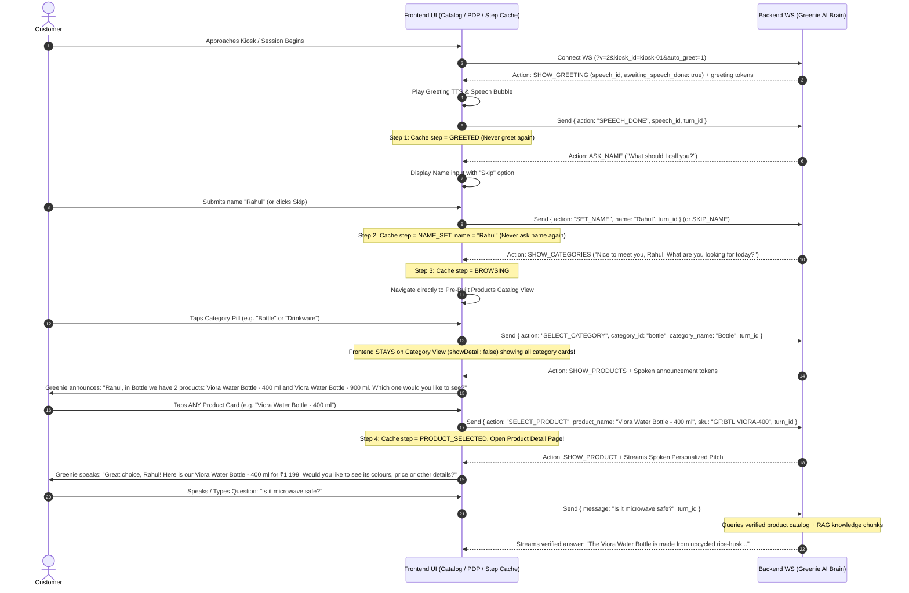

# Greenie AI Kiosk — Frontend Integration Guide & Architecture

> **Base URLs:**
> - **REST:** `http://localhost:5007`
> - **WebSocket:** `ws://localhost:5007`
> - **Protocol Version:** `v=2`
> - **Welcome Intro Videos:** `GET /media/intro-videos` and `GET /media/demo` (See [docs/intro-videos.md](docs/intro-videos.md))

---

## 1. Flow Overview & Interaction Lifecycle

Greenie operates as an interactive AI salesperson. The interaction lifecycle is dynamic, personalized, and designed so that category selection never auto-jumps into a single product card, but instead presents the entire collection while Greenie speaks the highlights.



---

## 2. Dynamic Flow Details (Exactly What to Implement)

### Step 1: Connect WebSocket with Conditional `auto_greet`
```javascript
const sessionId = KioskStepCache.getOrCreateSessionId();
const isAlreadyGreeted = KioskStepCache.hasPassedStep(KIOSK_STEPS.GREETED);

// If already greeted, connect with auto_greet=0 so backend never re-greets on reconnect!
const autoGreetParam = isAlreadyGreeted ? "0" : "1";
const wsUrl = `ws://localhost:5007/ws/${sessionId}?v=2&kiosk_id=kiosk-01&auto_greet=${autoGreetParam}`;

const ws = new WebSocket(wsUrl);
```

---

### Step 2: Avatar Greeting & `SPEECH_DONE` Acknowledgement
Backend sends `SHOW_GREETING` action on connect. When your TTS finishes playing the greeting audio, send:

```javascript
ws.send(JSON.stringify({
  action: "SPEECH_DONE",
  speech_id: currentSpeechId,
  turn_id: "turn_" + Date.now()
}));
KioskStepCache.setCurrentStep(KIOSK_STEPS.GREETED);
```

---

### Step 3: Avatar Asks Name (`ASK_NAME`)
Backend responds with action `ASK_NAME` ("What should I call you?").

* If customer enters name:
```javascript
ws.send(JSON.stringify({
  action: "SET_NAME",
  name: "Rahul",
  turn_id: "turn_" + Date.now()
}));
KioskStepCache.setCustomerName("Rahul");
KioskStepCache.setCurrentStep(KIOSK_STEPS.NAME_SET);
```

* If customer taps Skip:
```javascript
ws.send(JSON.stringify({
  action: "SKIP_NAME",
  turn_id: "turn_" + Date.now()
}));
KioskStepCache.setCurrentStep(KIOSK_STEPS.NAME_SET);
```

---

### Step 4: Navigate Directly to Products Catalog (`SHOW_CATEGORIES`)
Backend responds with action `SHOW_CATEGORIES` ("Nice to meet you, Rahul! What are you looking for today?").

* Frontend closes onboarding modal and navigates directly to your pre-built products page (`All Products`, `Bottle`, `Drinkware`, `Kitchen & Dining`).
* Sets `KioskStepCache.setCurrentStep(KIOSK_STEPS.BROWSING)`.

---

### Step 5: When Customer Taps a Category Pill (Dynamic Category Selection)

> **Key Rule:** Category selection does **NOT** auto-open any product detail page. The frontend **stays on the category view (`showDetail: false`)** displaying all product cards in that category.

When the customer taps a category pill (e.g. Bottle, Drinkware, Kitchen & Dining, All Products):

```javascript
ws.send(JSON.stringify({
  action: "SELECT_CATEGORY",
  category_id: category.id,       // e.g. "bottle" or "drinkware"
  category_name: category.name,   // e.g. "Bottle" or "Drinkware"
  turn_id: "turn_" + Date.now()
}));
```

#### Greenie's Response:
Greenie dynamically counts and announces the products in that category out loud:
* With customer name:
  > *"Rahul, in Bottle we have 2 products: Viora Water Bottle - 400 ml and Viora Water Bottle - 900 ml. Which one would you like to see?"*
* Without customer name (or if skipped):
  > *"In Bottle, we have 2 products: Viora Water Bottle - 400 ml and Viora Water Bottle - 900 ml. Which one would you like to see?"*

Backend returns action `SHOW_PRODUCTS`:
```json
{
  "type": "action",
  "data": {
    "action": "SHOW_PRODUCTS",
    "category": "Bottle",
    "count": 2,
    "products": [
      { "id": "viora-400", "sku": "GF:BTL:VIORA-400", "name": "Viora Water Bottle - 400 ml", "price": 1199 },
      { "id": "viora-900", "sku": "GF:BTL:VIORA-900", "name": "Viora Water Bottle - 900 ml", "price": 1499 }
    ],
    "message": "Rahul, in Bottle we have 2 products: Viora Water Bottle - 400 ml and Viora Water Bottle - 900 ml. Which one would you like to see?"
  }
}
```

#### Frontend Behavior:
* `showDetail` stays `false`.
* The category pills highlight the selected category.
* The product cards grid shows the products belonging to that category.
* Avatar speaks the dynamic announcement.

---

### Step 6: When Customer Taps ANY Product Card (Personalized "Great choice!")

When the customer taps any product card on your grid (or speaks its name):

```javascript
ws.send(JSON.stringify({
  action: "SELECT_PRODUCT",
  product_name: product.name, // e.g. "Viora Water Bottle - 400 ml" or "Classic Mug - Set of 4"
  sku: product.sku || product.id,
  turn_id: "turn_" + Date.now()
}));
KioskStepCache.setSelectedProduct(product);
KioskStepCache.setCurrentStep(KIOSK_STEPS.PRODUCT_SELECTED);
```

#### Greenie's Response:
Greenie greets the choice with the customer's name:
* With customer name:
  > *"Great choice, Rahul! Here is our Viora Water Bottle - 400 ml for ₹1,199. Would you like to see its colours, price or other details?"*
* Without customer name:
  > *"Great choice! Here is our Viora Water Bottle - 400 ml for ₹1,199. Would you like to see its colours, price or other details?"*

Backend returns action `SHOW_PRODUCT`:
```json
{
  "type": "action",
  "data": {
    "action": "SHOW_PRODUCT",
    "sku": "GF:BTL:VIORA-400",
    "product": {
      "name": "Viora Water Bottle - 400 ml",
      "price": 1199,
      "stock_status": "in_stock",
      "description": "Sage-green bottle made from upcycled rice-husk biocomposite."
    },
    "message": "Great choice, Rahul! Here is our Viora Water Bottle - 400 ml for ₹1,199. Would you like to see its colours, price or other details?"
  }
}
```

#### Frontend Behavior:
* Opens Product Detail Page (`showDetail: true`).
* Avatar streams the personalized pitch audio and lip-syncs.

---

### Step 7: Customer Speaks / Asks Any Question (RAG Q&A)

Once on the product detail page, if the customer asks any question by voice or text (e.g. *"Is it microwave safe?"*, *"Can I reheat food in it?"*, *"What are the materials?"*):

```javascript
ws.send(JSON.stringify({
  message: "Is it microwave safe?",
  turn_id: "turn_" + Date.now()
}));
```

#### Backend Response:
* Greenie queries the verified database product record and RAG knowledge chunks.
* Avatar streams back the verified answer directly into speech and captions.
* Stays on `showDetail: true` with active product context preserved.

---

## 3. Step Caching & Deduplication Architecture

### Step State Machine Levels

| Step Level | Constant | Description | Guard Rule |
|:---:|---|---|---|
| **0** | `INIT` | Fresh kiosk session; connecting WebSocket. | Only on initial load or full restart. |
| **1** | `GREETED` | Greeting played & `SPEECH_DONE` acknowledged. | Never replay greeting in same session. |
| **2** | `NAME_SET` | Customer submitted name or clicked Skip. | Never re-ask name in same session. |
| **3** | `BROWSING` | Viewing catalog grid or category filters. | Onboarding modal remains closed. |
| **4** | `PRODUCT_SELECTED` | Viewing product detail page & pitch; in Q&A. | Maintains product context for RAG inquiries. |

### Caching Implementation (`kioskStepCache.js`)

```javascript
export const KIOSK_STEPS = {
  INIT: 0,
  GREETED: 1,
  NAME_SET: 2,
  BROWSING: 3,
  PRODUCT_SELECTED: 4,
};

const CACHE_KEYS = {
  SESSION_ID: "greenie_kiosk_session_id",
  CURRENT_STEP: "greenie_kiosk_current_step",
  CUSTOMER_NAME: "greenie_kiosk_customer_name",
  SELECTED_PRODUCT: "greenie_kiosk_selected_product",
  ACKED_SPEECH_IDS: "greenie_kiosk_acked_speech_ids",
};

export const KioskStepCache = {
  getOrCreateSessionId() {
    let id = sessionStorage.getItem(CACHE_KEYS.SESSION_ID);
    if (!id) {
      id = "sess_" + Date.now() + "_" + Math.random().toString(36).substring(2, 7);
      sessionStorage.setItem(CACHE_KEYS.SESSION_ID, id);
    }
    return id;
  },
  getCurrentStep() {
    return parseInt(sessionStorage.getItem(CACHE_KEYS.CURRENT_STEP) || "0", 10);
  },
  setCurrentStep(step) {
    if (step >= this.getCurrentStep()) {
      sessionStorage.setItem(CACHE_KEYS.CURRENT_STEP, String(step));
    }
  },
  hasPassedStep(step) {
    return this.getCurrentStep() >= step;
  },
  getCustomerName() {
    return sessionStorage.getItem(CACHE_KEYS.CUSTOMER_NAME) || "";
  },
  setCustomerName(name) {
    sessionStorage.setItem(CACHE_KEYS.CUSTOMER_NAME, String(name || "").trim());
    this.setCurrentStep(KIOSK_STEPS.NAME_SET);
  },
  setSelectedProduct(p) {
    sessionStorage.setItem(CACHE_KEYS.SELECTED_PRODUCT, JSON.stringify(p));
    this.setCurrentStep(KIOSK_STEPS.PRODUCT_SELECTED);
  },
  markSpeechDone(speechId) {
    const raw = sessionStorage.getItem(CACHE_KEYS.ACKED_SPEECH_IDS);
    const ids = raw ? JSON.parse(raw) : [];
    if (!ids.includes(speechId)) {
      ids.push(speechId);
      sessionStorage.setItem(CACHE_KEYS.ACKED_SPEECH_IDS, JSON.stringify(ids.slice(-30)));
    }
    this.setCurrentStep(KIOSK_STEPS.GREETED);
  },
  clearCache() {
    sessionStorage.clear();
  },
};
```

---

## 4. Frame Sanitizer Helper (`formatActionFrame`)

Backend uses strict Pydantic validation (`extra = 'forbid'`). Always sanitize frames before sending:

```javascript
export function buildActionFrame(action, payload = {}, turnId = null) {
  const tid = turnId || "turn_" + Date.now();
  const frame = {
    v: 2,
    action,
    turn_id: tid,
  };

  switch (action) {
    case "SET_NAME":
      frame.name = String(payload.name || payload.customer_name || "").trim();
      break;

    case "SELECT_CATEGORY":
      if (payload.category_id || payload.categoryId) {
        frame.category_id = String(payload.category_id || payload.categoryId).trim().toLowerCase();
      }
      if (payload.category_name || payload.categoryName || payload.name) {
        frame.category_name = String(payload.category_name || payload.categoryName || payload.name).trim();
      }
      if (payload.products && Array.isArray(payload.products)) {
        frame.products = payload.products.map(p => typeof p === "string" ? p : String(p.name || p.sku || p.id));
      }
      break;

    case "SELECT_PRODUCT":
      if (payload.product_name) {
        frame.product_name = String(payload.product_name).trim();
      } else if (payload.name) {
        frame.product_name = String(payload.name).trim();
      }
      if (payload.sku) {
        frame.sku = String(payload.sku).trim();
      } else if (payload.id && !frame.product_name) {
        frame.sku = String(payload.id).trim();
      }
      break;

    case "SPEECH_DONE":
      frame.speech_id = String(payload.speech_id).trim();
      break;

    case "SKIP_NAME":
    case "SHOW_ALL":
    case "NAVIGATE_BACK":
    case "RESTART":
      break;
  }

  return frame;
}
```

---

## 5. Summary Reference Table

| Action / Event | Direction | Payload Example | Expected Outcome |
|---|---|---|---|
| Connect WS | Frontend → Backend | `ws://.../ws/sess_123?v=2&kiosk_id=kiosk-01&auto_greet=1` | Establishes streaming session. Auto-greets if fresh. |
| `SPEECH_DONE` | Frontend → Backend | `{ action: "SPEECH_DONE", speech_id: "...", turn_id: "..." }` | Acknowledges greeting audio played. Advances to name prompt. |
| `SET_NAME` | Frontend → Backend | `{ action: "SET_NAME", name: "Rahul", turn_id: "..." }` | Sets name; backend triggers `SHOW_CATEGORIES`. |
| `SKIP_NAME` | Frontend → Backend | `{ action: "SKIP_NAME", turn_id: "..." }` | Skips name; backend triggers `SHOW_CATEGORIES`. |
| `SELECT_CATEGORY` | Frontend → Backend | `{ action: "SELECT_CATEGORY", category_id: "bottle", category_name: "Bottle", turn_id: "..." }` | Stays on category grid. Greeny announces products in category. |
| `SELECT_PRODUCT` | Frontend → Backend | `{ action: "SELECT_PRODUCT", product_name: "Viora Water Bottle - 400 ml", sku: "GF:BTL:VIORA-400", turn_id: "..." }` | Opens PDP. Greeny greets: *"Great choice, {name}!..."* and pitches. |
| Product Question | Frontend → Backend | `{ message: "Is it microwave safe?", turn_id: "..." }` | RAG checks verified facts and answers out loud. |
| `RESTART` | Frontend → Backend | `{ action: "RESTART", turn_id: "..." }` | Wipes session and restarts fresh. |
